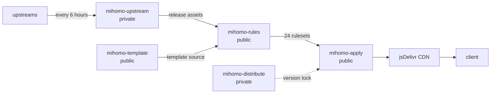

# CauriumX

> Proxy rulesets and subscription templates, built and verified in-repo.

<div align="center">

[][ci]
[][tags]
[][osi]

</div>

## Why

A routing config that points at third-party ruleset hosts inherits their
availability, their censorship decisions, and their silent changes. When one of
those hosts goes down or reshuffles its lists, every client breaks, and nothing
tells you it happened.

This organisation mirrors every ruleset it uses, merges multi-source sets under
a declared policy, and verifies the result before it reaches a client. The
routing path contains no third-party host.

## What

Five repositories, one pipeline. Each has a single responsibility, and any one
of them can be rebuilt from the others.

| Repository | Visibility | Role |
|---|---|---|
| [mihomo-rules][rules] | public | Fetch upstreams, merge multi-source sets, filter, diff |
| [mihomo-template][tpl] | public | Subscription template source, with version placeholders |
| [mihomo-apply][apply] | public | Versioned release: template and rulesets at one tag |
| mihomo-upstream | private | Raw upstream snapshots, archived as release assets |
| mihomo-distribute | private | Consumer version locking, holds subscription credentials |

The two private repositories are not linked because they are not readable
without access. Their roles are listed for completeness.

## Structure



The upstream stage runs on a schedule. Everything after it is triggered by a
human pushing a version, or by a change in the repository it reads from.

## Quick start

Subscribe with a pinned tag. Never use a drifting ref (`@main`, `@latest`): a
pinned tag cannot change under you, so a rollback is always possible.

```
https://cdn.jsdelivr.net/gh/CauriumX/mihomo-apply@<version>/template.yaml
```

Replace `<version>` with a tag from [the tags list][tags]. The current one is
`v0.1.2`.

Reference a single ruleset:

```yaml
rule-providers:
  AI-Site:
    type: http
    behavior: domain
    format: mrs
    url: "https://cdn.jsdelivr.net/gh/CauriumX/mihomo-apply@v0.1.2/site/AI-Site.mrs"
    path: ./ruleset/AI-Site.mrs
    proxy: DIRECT
    interval: 600
```

## Design rules

These are the invariants the pipeline enforces. Each exists because breaking it
caused a silent failure at some point.

**Template and rulesets ship at the same version.** A template pinned to one
commit while its rulesets drift on `@main` is an incompatibility that produces
no error, only a wrong routing table. `check-version-contract.mjs` fails the
build instead.

**Upstream addresses are environment variables.** No default value embeds a real
host. Raw snapshots live in a private repository because they carry the upstream
`AUTHOR` and `REPO` headers.

**`mrs` does not support `DOMAIN-KEYWORD`.** mihomo's `domainStrategy.Insert()`
treats the whole line as a literal domain and ignores the prefix. Keyword rules
that matter are inlined in the template's `rules:` section, before the matching
`RULE-SET`.

**Only one repository holds credentials.** The upstream, aggregate, template,
and apply stages handle public data only. Even if one of them is compromised,
the subscription service stays out of reach.

## Verification

Every repository runs its own CI.

| Repository | Checks |
|---|---|
| mihomo-rules | Unit tests, ruleset overlap contracts, doc-reference assertions |
| mihomo-template | Structure, version contract, provider provenance, loads in real mihomo |
| mihomo-apply | MANIFEST to file sha256 both ways, VERSION consistency, CDN check after release |
| mihomo-distribute | Unit tests, CDN reachability, provider version consistency after lock |

## Adopting

Upstream addresses are not committed. A new ruleset must be registered in
`ruleset/SOURCES.md` with its provenance and overlap rate before it can be
merged. A change crossing the 30% size threshold reports `BLOCK` and requires
human confirmation.

Ruleset artefacts are committed because the release repository references them
by URL. Ignoring them would 404 every provider in the subscription.

## License

MIT. Each repository carries its own `LICENSE`.

[ci]: https://github.com/CauriumX/mihomo-rules/actions
[tags]: https://github.com/CauriumX/mihomo-apply/tags
[osi]: https://opensource.org/licenses/MIT
[rules]: https://github.com/CauriumX/mihomo-rules
[tpl]: https://github.com/CauriumX/mihomo-template
[apply]: https://github.com/CauriumX/mihomo-apply